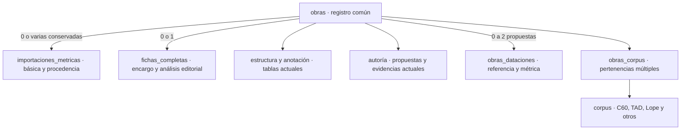

# Control de obras y separación de la elaboración completa

Referencia vigente del modelo acordado para el control editorial. El [inventario generado](dependencias.md)
localiza campos y consumidores. Las tareas pendientes se mantienen solo en [PENDIENTES](../PENDIENTES.md).
El [resultado generado del ensayo](validacion.md) distingue lo probado de lo pendiente de despliegue.

**Estado:** modelo editorial y dataciones activos en Supabase y en la aplicación publicada.
La migración `20261110200000` conserva los originales; el CSV está incorporado sin sustituir
fechas o encargos existentes. La computación pública está regenerada y las comprobaciones SQL
y HTTP de producción son correctas. La contracción `20261110220000` retira las columnas anteriores después de validar
sus consumidores y la recuperación con datos posteriores. `.env.local` no se ha modificado.
El [resultado del cambio editorial](cambio-verificado.md) recoge las evidencias generadas.

## Modelo acordado

Una obra existe antes de tener ficha. `obras` conserva identidad, títulos y género;
`obras_dataciones` reúne sus propuestas de fecha. Las propuestas de autoría y evidencias siguen
en sus tablas actuales. Se reutilizan
las evidencias tradicional y estilometría léxica, sin crear columnas paralelas por proveedor.

`fichas_completas`, opcional y única por obra, reúne encargo, responsable, fecha de asignación,
inicio explícito, edición base, bibliografía, observaciones del editor, declaraciones generales,
estado editorial y publicación. Un encargo puede existir antes de iniciar la anotación. Una fecha
de asignación o una fila heredada no acreditan el inicio del trabajo.

En Control de obras, «Ficha» distingue «Sin ficha», «Básica» y «Completa». «Estado» describe
el flujo de la completa. Una obra registrada sin encargo puede importarse como básica o pasar
a completa al asignarla o iniciar su elaboración. Un encargo nuevo aparece «Por iniciar» hasta
que el editor inicia el borrador. Las básicas pueden consultarse desde el listado. La vista previa
editorial y el enlace a una ficha publicada y visible tienen acciones propias.

`importaciones_metricas` conserva quién importó, cuándo, el JSON recibido y el confirmado. La edición
de la básica está en `datos_confirmados.metadatos.edicion_base`; no se depende de `obras.edicion`
para reconstruirla. El JSON original no tiene por qué contener todos los metadatos añadidos al confirmar.

La estructura editable y las caracterizaciones siguen en jornadas, cuadros, secuencias y tablas
asociadas. Las declaraciones generales se trasladan a la completa conservando su función: rellenar
respuestas pendientes y rechazar contradicciones. Un booleano general desmarcado no afirma presencia.



Las básicas confirmadas podrán aportar a los análisis autorizados, sin ficha pública individual.
La integración de sus productores sigue pendiente. Encargar o iniciar una completa no cambia
automáticamente el referente analítico. El mecanismo de transición y sustitución queda fuera
de esta preparación; la importación original siempre permanece consultable.

El listado global y la gestión de corpus/asignaciones son exclusivos de admin/IP. Los editores
mantienen sus encargos y la consulta autorizada de la importación de origen. No se elimina
incidentalmente el permiso de consulta de básicas concedido por la capacidad de importación.
Las pertenencias a corpus son múltiples, sin jerarquías obligatorias. Plus es «Sin corpus».

## Traslado de campos

| Campo trasladado desde obras | Ubicación vigente |
| --- | --- |
| `obras.edicion` | `fichas_completas.edicion_base` para completas; la básica conserva su edición en el JSON confirmado |
| `editor_asignado`, `fecha_asignacion` | `fichas_completas` |
| `bibliografia`, `observaciones` | `fichas_completas` para el análisis del editor; las notas de importación permanecen en sus documentos |
| `sin_figuras_donaire`, `sin_personajes_sobrenaturales`, `sin_eventos_sobrenaturales` | `fichas_completas`, con funciones y controles adaptados |
| `estado`, `visible_publico`, `fecha_cambio_estado`, `fecha_publicacion`, `autor_ficha_publico` | `fichas_completas` |
| `obras.tipo_ficha` | Proyección por importación y elaboración existentes; `basica` en contratos nuevos |
| `fecha_inicio_trad`, `fecha_fin_trad`, `fuente_fecha` | `obras_dataciones`, clase `referencia`, con fuente copiada literalmente |
| `fecha_inicio_metadrama`, `fecha_fin_metadrama` | `obras_dataciones`, clase `metrica` |
| Revisores e historial | Se conservan tablas y datos; obras_revisores exige una ficha completa mediante FK |

Título, variantes, slug y género siguen en `obras`. `total_versos` sigue ligado a la estructura
de trabajo, sin duplicarlo en el nuevo registro.

### Dataciones

Disponibles en el formulario, API y consumidores. Cada obra admite una **datación de
referencia** (la propuesta por el editor o un estudio) y una **datación métrica** (el posible
afinamiento a partir del análisis). Ambas tienen `inicio`, `fin`, `inicio_inclusivo`,
`fin_inclusivo`, `aproximada` y `fuente`. No hay estado de revisión, revisor ni fecha de revisión:
el editor puede cambiar o conservar las fechas y autorías recibidas del CSV sin registrar esa decisión.

`1600 o antes` significa ≤1600; `antes de 1600`, <1600. Los límites inferiores funcionan igual.
Una publicación de 1600 permite un límite ≤1600, sin excluir automáticamente ese año. En filtros
y análisis, los extremos estrictos equivalen al último o primer año entero admisible; el texto
mostrado conserva el límite original. Un extremo ausente sigue abierto. La media se calcula solo
si existen ambos extremos finitos y no se almacena. La aproximación se conserva sin inventar un
margen numérico. La métrica no sustituye automáticamente a la referencia.

La migración copió las fechas anteriores y `fuente_fecha` literalmente. Las columnas antiguas
se retiraron en la contracción; la proyección conserva los nombres de lectura anteriores
además del contrato tipado `dataciones`. Formulario, API, catálogo, ficha, autor,
comparativas y ensayo analítico usan el contrato nuevo. Guardar otros metadatos no borra fechas
ni calificadores. La modificación invalida los resúmenes de obra y autor.
La única corrección de fecha autorizada en la migración es *El esclavo del demonio*: el 1612
de la edición pasa del campo inicial a un límite superior inclusivo (≤1612), con la fuente intacta.
La migración comprobó su dato de origen antes de corregirlo.

El importador conserva su contrato histórico de intervalos y sus JSON; no se añaden claves a
las copias confirmadas. Al importar sobre una obra registrada se conserva su datación vigente
si ya tiene límites, incluidos los recibidos del CSV. El productor analítico recibe las fechas
vigentes aparte de la importación, que permanece intacta. La edición de básicas sigue pendiente.

El CSV solo completa límites vacíos y conserva las fuentes anteriores. Su cargador reconoce
intervalos, aproximaciones y límites; las discrepancias con una fecha existente se mantienen
para revisión, sin sustituirla. No se crea un flujo de «provisional» o «revisada».
El [ensayo ampliado](cambio-verificado.md) recoge las diferencias por obra. En el despliegue
coordinado se debe regenerar la computación completa para que todos los artefactos incorporen
el contrato nuevo, incluidas las obras cuyas fechas no hayan cambiado.

Los formatos históricos `versologia-ficha-minima/*`, sus hashes y las migraciones aplicadas son
inmutables. El cambio interno a `basica` afecta contratos y escritores nuevos: exige lectores
compatibles, no reescribir JSON confirmados para cambiarles el nombre.

## Inventario y riesgos comprobados

La inspección viva guarda columnas, restricciones, políticas, disparadores, funciones completas,
referencias a obras, historial de migraciones y huellas de importación en `backups/` privado.
El [informe público generado](dependencias.md) no contiene cuentas, valores de obras ni credenciales.
Los nombres de campos comunes producen candidatos textuales que requieren revisión semántica.

Las familias que deben adaptarse conjuntamente son:

- **Acceso y RLS:** `auth_puede_editar_obra`, consulta de importaciones, vista previa pública,
  políticas sobre obras y relaciones. La política permisiva de listado actual no se cierra ocultando un botón.
- **Encargos:** creación por lotes, `gestionar_asignaciones_lote`, revisores, historial y perfiles
  de editores. Se conserva la comprobación de selección concurrente y el registro de cambios.
- **Editor y API:** cargas y tipos, checklist, datos, observaciones, estado, visibilidad, declaraciones
  generales y estructura. No todos los usos de `estado` u `observaciones` pertenecen a obras.
- **Importador:** guardado, coincidencias, listado, eliminación, guardas contra escritura v2 y
  consulta del origen. El guardado sobre obra existente debe ser explícito y no sobrescribir completas.
- **Productores públicos:** ficha, autor, equipo, índices, perfiles, corpus comparativo, recompute
  y cola. Conservar contratos y última copia coherente mientras se recalculan artefactos.
- **Herramientas:** tipos generados, snapshots, informes, semillas, guiones y pruebas locales.
  Las migraciones históricas se inventarían, nunca se editan.

La migración inicial conservó las completas como `procedencia_registro='legado'`, con
`inicio_elaboracion=NULL`. La reclasificación posterior `20261111140000`, aplicada y verificada en Supabase,
se limita a 38 registros
de planificación cotejados sin asignación ni actividad editorial. Conserva las obras, dataciones,
autorías y pertenencias. Para el resto de completas heredadas, la fecha de inicio sigue siendo desconocida.

## Modelo aplicado y contratos

Las migraciones aplicadas son inmutables:

- `20261110200000_control_de_obras_y_dataciones.sql`: expansión, traslado de datos,
  escritores, RPC, permisos y dataciones. Conservó íntegros los registros originales al cambiar
  la autoridad y marcó los artefactos para su regeneración.
- `20261110220000_contraer_modelo_de_obras.sql`: retiró las columnas congeladas, el escritor
  `guardar_ficha_minima`, las políticas de escritura antiguas y la vista de preparación.
  La transacción comprobó que todas las filas de la vista editorial permanecieran idénticas.

`obras` conserva nueve columnas: identidad, título, título normalizado, variantes, género,
versos totales, slug y fechas de creación/actualización. Los índices de encargo, estado y
visibilidad pertenecen a `fichas_completas`. Los revisores requieren una completa mediante FK;
el historial conserva su relación con la obra.

`obras_editoriales` es una vista con escritura mediante trigger: el núcleo va a `obras`,
el análisis a `fichas_completas` y las propuestas de fecha a `obras_dataciones`.
El núcleo no admite escritura directa de usuarios. El escritor bloquea la fila y rechaza con
40001 un guardado que haya quedado desfasado por una reasignación concurrente.
`obras_consulta_publica` solo entrega metadatos autorizados, con el muro de estado y visibilidad
por obra. Los productores públicos leen el nuevo modelo; los JSON se regeneraron y confirmaron.

Los tipos de `database.types.ts` se generan literalmente desde Supabase. Las garantías no
inferidas de las vistas y su escritura por trigger se expresan aparte en
`obra-editorial.types.ts` y `database-client.types.ts`. No se añaden tablas ficticias al archivo generado.
El servidor utiliza las proyecciones vigentes; no hace falta una variable de activación.

Los formularios antiguos que intentan guardar fechas con el contrato anterior reciben 409:
se deben conservar los cambios y recargar. El importador conserva su formato de JSON histórico,
pero escribe mediante `guardar_ficha_basica`. Importar sobre un registro sin ficha exige elegir
su identidad, bloquea esa obra y conserva sus metadatos y autorías vigentes. La asignación y el
inicio explícito de la completa son operaciones separadas; no convierten una básica.

El control global incluye básicas, completas y registros sin ficha. Admin/IP puede filtrar,
ordenar, encargar completas y gestionar pertenencias múltiples a corpus. Los editores conservan
sus encargos, revisiones y consulta autorizada de importaciones. La carga del CSV completa vacíos,
conserva fuentes anteriores y añade evidencias a las propuestas existentes. No hay estado de revisión.
Las diferencias conservadas se muestran en el [informe generado](cambio-verificado.md).

## Copias, ensayo y recuperación

Se siguió el [procedimiento de copia](../../README.md) antes del traslado y de la contracción:
esquema, datos, roles, esquemas administrados, historial e instantánea consistente de PostgreSQL,
además de un JSON legible por obra. Los volcados privados permanecen en `backups/`; cada copia
sellada tiene otra carpeta con todos sus archivos verificados por SHA-256.
La réplica está en el mismo disco. No incluye objetos binarios externos de Storage o OneDrive.

Las restauraciones usan un contenedor propio etiquetado `versologia.tarea=control-obras`,
sin red ni puertos, y bases nuevas para conservar los ensayos previos. Se restauró el esquema
administrado actual, evitando depender de una plantilla de Storage/Auth que pudiera quedar antigua.
Se contrastaron huellas de todas las tablas y se ejecutaron los consumidores, no solo la sintaxis.

Herramientas reproducibles desde la raíz:

```powershell
node scripts/control-obras/preparar-copia-despliegue.mjs
node scripts/control-obras/restaurar-copia-nueva.mjs
node scripts/control-obras/preparar-contraccion.mjs
node scripts/control-obras/validar-contraccion-local.mjs
node scripts/control-obras/materializar-contraccion.mjs
node scripts/control-obras/verificar-integridad-produccion.mjs backups/control-obras/produccion/<carpeta>
```

Los preparadores de las migraciones ya aplicadas se conservan para reproducir su ensayo sobre
una copia anterior, no para ejecutarlos de nuevo sobre el esquema actual. Las candidatas se
mantuvieron fuera de `db push` hasta comprobar los mismos bytes. Las lecturas y copias de CLI
se ejecutan secuencialmente porque comparten una credencial temporal.

La recuperación no consiste en restaurar un volcado antiguo sobre el trabajo actual.
La reversión de contracción reconstruye las columnas con los metadatos vigentes, mantiene fechas,
corpus, análisis y procedencia y preserva las marcas de actualización. Se probó una edición y una
fecha estricta añadidas después del cambio, su recuperación y la reaplicación sin alterar su contrato.
El escritor también se protege frente a definiciones cambiadas después del inventario.

Las pruebas de aplicación utilizan Auth/PostgREST y cuentas sintéticas solo locales; no correos
reales. El servidor de integración usa 5195 y su puente de loopback, sin tocar el servidor habitual,
y se detuvo al terminar. Las lecturas HTTP de producción usan la contraseña global únicamente
para el dominio publicado, con autorización del usuario, y no sustituyen una revisión visual.

La revisión visual inicial cubrió corpus y encargos; la herramienta dejó de responder antes de
cerrar el repaso del formulario. La carga SSR, las API y los permisos sí se comprobaron.
La edición de básicas y la transición básica → completa conservan el alcance separado acordado;
la incorporación de sus productores a los análisis se sigue en [PENDIENTES](../PENDIENTES.md).
