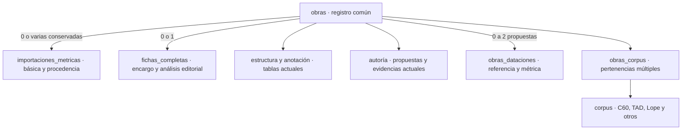

# Control de obras y separación de la elaboración completa

Referencia vigente del modelo acordado para el control editorial. El [inventario generado](dependencias.md)
localiza campos y consumidores. Las tareas pendientes se mantienen solo en [PENDIENTES](../PENDIENTES.md).
El [resultado generado del ensayo](validacion.md) distingue lo probado de lo pendiente de despliegue.

**Estado:** expansión y cambio de lectores/escritores implementados y ensayados en restauración
aislada; aplicación adaptada con activación explícita `OBRAS_EDITORIALES_V2=true`, desactivada por
defecto. El nuevo modelo no se ha desplegado en Supabase; `.env.local` permanece intacto. Las candidatas permanecen fuera
de `supabase/migrations/`, restringidas a la base de ensayo. No son un despliegue automático.
El [resultado del cambio editorial](cambio-verificado.md) complementa el ensayo inicial.

## Modelo acordado

Una obra existe antes de tener ficha. `obras` conserva identidad, títulos y género;
`obras_dataciones` reúne sus propuestas de fecha. Las propuestas de autoría y evidencias siguen
en sus tablas actuales. Se reutilizan
las evidencias tradicional y estilometría léxica, sin crear columnas paralelas por proveedor.

`fichas_completas`, opcional y única por obra, reúne encargo, responsable, fecha de asignación,
inicio explícito, edición base, bibliografía, observaciones del editor, declaraciones generales,
estado editorial y publicación. Un encargo puede existir antes de iniciar la anotación. Una fecha
de asignación o una fila heredada no acreditan el inicio del trabajo.

`importaciones_metricas` conserva quién importó, cuándo, el JSON recibido y el confirmado. La edición
de la básica está en `datos_confirmados.metadatos.edicion_base`; no se depende de `obras.edicion`
para reconstruirla. El JSON original no tiene por qué contener todos los metadatos añadidos al confirmar.

La estructura editable y las caracterizaciones siguen en jornadas, cuadros, secuencias y tablas
asociadas. Las declaraciones generales se trasladan a la completa conservando su función: rellenar
respuestas pendientes y rechazar contradicciones. Un booleano general desmarcado no afirma presencia.



Las básicas confirmadas podrán aportar a los análisis autorizados, sin ficha pública individual.
La integración de sus productores sigue pendiente. Encargar o iniciar una completa no cambia
automáticamente el referente analítico. El mecanismo de transición y sustitución queda fuera
de esta preparación; la importación original siempre permanece consultable.

El listado global y la gestión de corpus/asignaciones serán exclusivos de admin/IP. Los editores
mantienen sus encargos y la consulta autorizada de la importación de origen. No se elimina
incidentalmente el permiso de consulta de básicas concedido por la capacidad de importación.
Las pertenencias a corpus son múltiples, sin jerarquías obligatorias. Plus es «Sin corpus».

## Traslado de campos

| Origen actual | Destino final |
| --- | --- |
| `obras.edicion` | `fichas_completas.edicion_base` para completas; la básica conserva su edición en el JSON confirmado |
| `editor_asignado`, `fecha_asignacion` | `fichas_completas` |
| `bibliografia`, `observaciones` | `fichas_completas` para el análisis del editor; las notas de importación permanecen en sus documentos |
| `sin_figuras_donaire`, `sin_personajes_sobrenaturales`, `sin_eventos_sobrenaturales` | `fichas_completas`, con funciones y controles adaptados |
| `estado`, `visible_publico`, `fecha_cambio_estado`, `fecha_publicacion`, `autor_ficha_publico` | `fichas_completas` |
| `obras.tipo_ficha` | Proyección por importación y elaboración existentes; `basica` en contratos nuevos |
| `fecha_inicio_trad`, `fecha_fin_trad`, `fuente_fecha` | `obras_dataciones`, clase `referencia`, con fuente copiada literalmente |
| `fecha_inicio_metadrama`, `fecha_fin_metadrama` | `obras_dataciones`, clase `metrica` |
| Revisores e historial | Se conservan tablas y datos; la relación deberá exigir elaboración completa al efectuar el cambio definitivo |

Título, variantes, slug y género siguen en `obras`. `total_versos` sigue ligado a la estructura
de trabajo, sin duplicarlo en el nuevo registro.

### Dataciones

Implementadas y ensayadas en local; aún no desplegadas. Cada obra admite una **datación de
referencia** (la propuesta por el editor o un estudio) y una **datación métrica** (el posible
afinamiento a partir del análisis). Ambas tienen `inicio`, `fin`, `inicio_inclusivo`,
`fin_inclusivo`, `aproximada` y `fuente`. No hay estado de revisión, revisor ni fecha de revisión:
el editor puede cambiar o conservar las fechas y autorías recibidas del CSV sin registrar esa decisión.

`1600 o antes` significa ≤1600; `antes de 1600`, <1600. Los límites inferiores funcionan igual.
Una publicación de 1600 permite un límite ≤1600, sin excluir automáticamente ese año. En filtros
y análisis, los extremos estrictos equivalen al último o primer año entero admisible; el texto
mostrado conserva el límite original. Un extremo ausente sigue abierto. La media se calcula solo
si existen ambos extremos finitos y no se almacena. La aproximación se conserva sin inventar un
margen numérico. La métrica no sustituye automáticamente a la referencia.

La expansión copia las fechas anteriores y `fuente_fecha` literalmente. Las columnas antiguas
quedan congeladas para recuperación hasta la contracción; la proyección devuelve sus nombres
anteriores además del contrato tipado `dataciones`. Formulario, API, catálogo, ficha, autor,
comparativas y ensayo analítico usan el contrato nuevo. Guardar otros metadatos no borra fechas
ni calificadores. La modificación invalida los resúmenes de obra y autor.
La única corrección de fecha autorizada en la migración es *El esclavo del demonio*: el 1612
de la edición pasa del campo inicial a un límite superior inclusivo (≤1612), con la fuente intacta.
La candidata se detiene si esa fecha cambia antes de aplicarla.

El importador conserva su contrato histórico de intervalos y sus JSON; no se añaden claves a
las copias confirmadas. Al importar sobre una obra registrada se conserva su datación vigente
si ya tiene límites, incluidos los recibidos del CSV. El productor analítico recibe las fechas
vigentes aparte de la importación, que permanece intacta. La edición de básicas sigue pendiente.

El CSV solo completa límites vacíos y conserva las fuentes anteriores. Su cargador reconoce
intervalos, aproximaciones y límites; las discrepancias con una fecha existente se mantienen
para revisión, sin sustituirla. No se crea un flujo de «provisional» o «revisada».
El [ensayo ampliado](cambio-verificado.md) recoge las diferencias por obra. En el despliegue
coordinado se debe regenerar la computación completa para que todos los artefactos incorporen
el contrato nuevo, incluidas las obras cuyas fechas no hayan cambiado.

Los formatos históricos `versologia-ficha-minima/*`, sus hashes y las migraciones aplicadas son
inmutables. El cambio interno a `basica` afecta contratos y escritores nuevos: exige lectores
compatibles, no reescribir JSON confirmados para cambiarles el nombre.

## Inventario y riesgos comprobados

La inspección viva guarda columnas, restricciones, políticas, disparadores, funciones completas,
referencias a obras, historial de migraciones y huellas de importación en `backups/` privado.
El [informe público generado](dependencias.md) no contiene cuentas, valores de obras ni credenciales.
Los nombres de campos comunes producen candidatos textuales que requieren revisión semántica.

Las familias que deben adaptarse conjuntamente son:

- **Acceso y RLS:** `auth_puede_editar_obra`, consulta de importaciones, vista previa pública,
  políticas sobre obras y relaciones. La política permisiva de listado actual no se cierra ocultando un botón.
- **Encargos:** creación por lotes, `gestionar_asignaciones_lote`, revisores, historial y perfiles
  de editores. Se conserva la comprobación de selección concurrente y el registro de cambios.
- **Editor y API:** cargas y tipos, checklist, datos, observaciones, estado, visibilidad, declaraciones
  generales y estructura. No todos los usos de `estado` u `observaciones` pertenecen a obras.
- **Importador:** guardado, coincidencias, listado, eliminación, guardas contra escritura v2 y
  consulta del origen. El guardado sobre obra existente debe ser explícito y no sobrescribir completas.
- **Productores públicos:** ficha, autor, equipo, índices, perfiles, corpus comparativo, recompute
  y cola. Conservar contratos y última copia coherente mientras se recalculan artefactos.
- **Herramientas:** tipos generados, snapshots, informes, semillas, guiones y pruebas locales.
  Las migraciones históricas se inventarían, nunca se editan.

Se mantienen todos los registros hoy marcados `completa` como `procedencia_registro='legado'`,
con `inicio_elaboracion=NULL`. No se reclasifican obras por estar vacías ni se inventa la fecha
de inicio a partir de `created_at`, asignación o anotaciones. La interfaz deberá distinguir este
desconocimiento del estado «encargada, todavía no iniciada» de los registros nuevos.

## Preparación reproducible y copias

Se usa el procedimiento del [README principal](../../README.md): esquema, datos, roles y snapshot
por obra, secuencialmente. Se añaden los esquemas de Auth/Storage/historial y los datos del historial.
Las tablas internas `auth.schema_migrations` y `storage.migrations` se omiten en el volcado de datos
habitual; una instantánea adicional `datos-consistentes.dump` incluye en una sola transacción
los datos de `public`, `auth`, `storage` y `supabase_migrations`.

Los volcados contienen datos privados y hashes de acceso: permanecen en `backups/`, ignorado por Git.
No son copias de objetos binarios externos de Storage ni de los materiales de OneDrive. Se debe
comprobar si hay objetos que necesiten otra copia; en la preparación inicial Storage no tenía buckets
ni objetos. Dos carpetas en el mismo disco no constituyen redundancia frente a una avería del disco.

Herramientas de esta preparación, ejecutadas desde la raíz:

```powershell
node scripts/control-obras/inventariar.mjs <carpeta-copia>
node scripts/control-obras/huellas.mjs <carpeta-copia>
node scripts/control-obras/generar-dependencias.mjs <carpeta-copia>
node scripts/control-obras/copiar-instantanea.mjs <carpeta-copia>
```

Las lecturas remotas y copias de CLI se ejecutan secuencialmente porque comparten credencial
temporal. `copiar-instantanea.mjs` mantiene esas credenciales en memoria y nunca las imprime.
Los scripts no escriben filas del proyecto remoto.

Restauración en un contenedor propio de la misma imagen PostgreSQL, **sin red y sin puertos**,
etiquetado `versologia.tarea=control-obras`. Base nueva `control_obras_preparacion`, sin reutilizar
los entornos locales anteriores. La imagen trae los roles de plataforma; `roles.sql` restaura sus
ajustes, no es una exportación de contraseñas de roles administrados por Supabase.

```powershell
docker run -d --name versologia-control-obras-preparacion --network none --label versologia.tarea=control-obras -e POSTGRES_HOST_AUTH_METHOD=trust public.ecr.aws/supabase/postgres:17.6.1.136
docker exec versologia-control-obras-preparacion psql -X -U supabase_admin -d postgres -v ON_ERROR_STOP=1 -c "create database control_obras_preparacion template template0 encoding 'UTF8';" -c "alter system set cron.database_name = 'control_obras_preparacion';"
docker restart versologia-control-obras-preparacion
node scripts/control-obras/restaurar-local.mjs <carpeta-copia>
node scripts/control-obras/restaurar-instantanea-local.mjs <carpeta-copia>
node scripts/control-obras/validar-local.mjs <carpeta-copia>
node scripts/control-obras/validar-acceso-local.mjs <carpeta-copia>
node scripts/control-obras/generar-validacion.mjs <carpeta-copia>
node scripts/control-obras/sellar-copia.mjs <carpeta-copia>
```

Los restauradores rechazan sobrescribir obras o un ensayo expandido. El segundo archiva íntegra
la primera restauración antes de cargar la instantánea consistente. Las huellas de las tablas
de aplicación deben coincidir con la lectura remota; diferencias posteriores en sesiones Auth
se registran por separado y no se presentan como igualdad de instantes diferentes.

## Secuencia de migración y criterios de aceptación

1. **Expansión ensayada:** [candidata SQL](../../scripts/control-obras/001-expandir-ensayo.sql).
   Crea y rellena tablas nuevas; conserva columnas, funciones, artefactos y todas las filas originales.
   No carga pertenencias ni asignaciones del CSV. No concede escritura directa a `authenticated`.
   No se sirve desde la app y no se habilita ningún escritor nuevo mientras el origen siga en `obras`.
2. **Preparar lectores/escritores:** cargar el modelo conjunto, adaptar RPC y RLS, mover las guardas
   de declaraciones/publicación, resolver listado sin ficha y lector de formatos históricos. Esta
   adaptación es requisito para el cambio definitivo, no una consecuencia que pueda posponerse.
3. **Cambio coordinado:** nueva copia e inventario; ventana sin escrituras o sincronización
   transaccional explícitamente probada; volcar el delta final, sustituir lectores y escritores y
   dejar una sola fuente de verdad. Ensayar asignación, autosave, importación y publicación por roles.
4. **Contracción posterior:** retirar columnas de `obras` y el discriminador antiguo solo después
   de ejecutar sus consumidores y demostrar que no quedan referencias. No usar `DROP ... CASCADE`
   para ocultarlas. Retirar formatos operativos antiguos sin alterar sus documentos históricos.

La candidata de esta fase **no renombra aún el valor persistido `minima` ni retira columnas**:
hacerlo rompería los escritores y RPC desplegados. La proyección de ensayo ya expone `basica`.
Una migración definitiva no puede consistir en ejecutar directamente esta candidata en producción.

La definitiva se prepara con `preparar-copia-despliegue.mjs` y `preparar-migracion.mjs`.
El primero copia esquema, datos, roles, Auth/Storage, una instantánea consistente, inventario,
huellas y un JSON por obra. `ensayar-dataciones-desde-copia.mjs --actual --final` restaura el
esquema gestionado actual completo, comprueba las huellas y ejecuta migración, carga y reversión.
No basta una plantilla anterior: Storage puede incorporar tablas nuevas sin cambios del proyecto.

La candidata definitiva permanece en la carpeta privada de la copia, fuera de `db push`, hasta
la activación coordinada. Incluye bloqueo del registro e importaciones y comprueba dentro de la
transacción que no cambien sus filas originales. La carga del CSV es una operación separada,
idempotente y ensayada; la regeneración completa se ejecuta después. Los finales de línea se
normalizan antes del ensayo para que Git conserve exactamente los bytes probados.

El despliegue empieza publicando la aplicación compatible con activación deshabilitada. El cambio
de autoridad y la activación requieren una ventana sin escritores anteriores. Los formularios
abiertos antes del cambio reciben 409 si intentan guardar el formato antiguo de fechas; deben
conservar los cambios y recargar. Después se verifican permisos, autosave, corpus y publicación.
La bandera solo selecciona lectores/escritores: desactivarla por sí sola no revierte la base.

Validación automática local: recuentos y huellas de todas las tablas copiadas; FK por anti-joins
porque la restauración desactiva triggers para resolver referencias circulares; hashes de los
JSON confirmados; copia exacta de los campos; repetición idempotente; ausencia de fechas inventadas
y pertenencias inferidas; aislamiento de acceso; ejecución real de permisos y productor de ficha
sobre todas las obras; recompute completo dentro de transacción revertida; reversión y reaplicación.

La [reversión del ensayo](../../scripts/control-obras/revertir-expansion-ensayo.sql) elimina únicamente
la expansión local. Solo es válida mientras ninguna escritura nueva dependa de esas tablas. Después
del cambio de autoridad, la recuperación exige revertir también la aplicación y preservar el delta
posterior; restaurar una copia antigua sobre producción perdería ese trabajo y no es una reversión aceptable.

## Cambio editorial implementado en la candidata local

`generar-cambio.mjs` compone [002-cambio-ensayo.sql](../../scripts/control-obras/002-cambio-ensayo.sql)
desde las definiciones de funciones auditadas y [cambio-editorial.sql](../../scripts/control-obras/cambio-editorial.sql).
Se debe regenerar desde un inventario reciente antes de preparar un despliegue: no sustituir funciones
que hayan cambiado en producción por las capturadas en una copia anterior.

```powershell
node scripts/control-obras/generar-cambio.mjs <carpeta-copia>
node scripts/control-obras/aplicar-cambio-local.mjs
node scripts/control-obras/probar-cambio-local.mjs
node scripts/control-obras/probar-api-local.mjs
```

Tras esta fase, no ejecutar la reversión de expansión inicial: las vistas y funciones nuevas ya
dependen de esas tablas. La copia anterior al cambio queda preservada separadamente. Una reversión
coordinada posterior deberá preservar los cambios de la completa antes de volver al modelo anterior.
`preparar-migracion.mjs` genera esa reversión conservadora junto a la copia: traslada los últimos
datos al contrato anterior y mantiene las tablas nuevas, incluidas dataciones y corpus. Su ensayo
añade una edición y una datación después del cambio y comprueba que sobrevivan a la reversión.
El contrato anterior no muestra todos los calificadores, aunque se conserven en sus tablas.

- `obras_editoriales` entrega el contrato conjunto al editor; un trigger INSTEAD OF dirige metadatos
  comunes al núcleo y el análisis a `fichas_completas`. La escritura directa del núcleo queda revocada
  para usuarios. Las columnas editoriales antiguas se conservan congeladas para recuperación, no se
  sincronizan ni son el origen de las lecturas nuevas. Su retirada física pertenece a la contracción.
- `obras_consulta_publica` entrega solo identidad, datación y visibilidad, con muro de estado por obra.
  La consulta editorial privada no se abre a anónimos. Se conserva la relación anidada con los resúmenes.
- Los disparadores de publicación, crédito, declaraciones e invalidación se trasladan a la completa.
  Los cuerpos de funciones se adaptan a la proyección, manteniendo los contratos de los artefactos.
- La RPC `iniciar_ficha_completa` separa encargo e inicio y rechaza convertir una básica. La asignación
  habitual sigue utilizando la RPC de lotes con su historial y control de concurrencia.
- `guardar_ficha_basica` admite un destino sin ficha ni estructura, bloquea su fila y conserva sus
  metadatos y autorías vigentes, completando los vacíos. La referencia de la edición permanece en el
  JSON confirmado. El destino forma parte de la huella y la comprobación idempotente de la petición.
  El escritor antiguo `guardar_ficha_minima` queda sin permiso de ejecución para usuarios y servicio;
  revocar únicamente la tabla no bastaría para desactivar una función SECURITY DEFINER.
- El control incluye ambos tipos, registro sin ficha, filtros por autoría/tipo/corpus, ordenación por
  inicio/fin/media, autoría, editor y corpus; creación y edición de nombres de corpus, y pertenencias
  aditivas o retiradas en lote. Las pertenencias del CSV todavía no se han escrito.
- La ruta y API de listado global rechazan a editores. Una cookie antigua con ámbito global se
  restablece a «Mis obras». La consulta de básicas por capacidad de importación conserva su recorrido.

El servidor selecciona la relación a través de `src/lib/server/modelo-obras.ts`. La bandera no crea
tablas ni cambia credenciales: activarla contra un esquema sin migrar produciría errores. El cambio
debe coordinarse con el despliegue en una ventana sin escritores anteriores. No hay dual write.
Los scripts editoriales usan `consulta-editorial.mjs` para detectar la proyección cuando exista;
los inventarios y validadores de copias siguen leyendo deliberadamente las tablas físicas.

Las pruebas SQL (`probar-cambio-local.mjs`) usan transacciones revertidas. Las HTTP
(`probar-api-local.mjs`) ejecutan PostgREST en loopback dentro del contenedor sin red ni puertos;
usan contraseña y JWT sintéticos locales, eliminan su registro de prueba y detienen su API. No arrancan
un servidor web de la aplicación ni alteran los entornos locales anteriores. Para prepararlas se copia
el binario `/bin/postgrest` del contenedor local existente a `/tmp/postgrest` del contenedor aislado.

El cierre funcional incluye inicio explícito, políticas de estructura/autoría basadas en el nuevo
encargo, selección conservada al gestionar corpus y catálogo cargado sin anotaciones del laboratorio.
Las pruebas de aplicación ejercitan creación, encargo, inicio, datos, estructura, métrica, reintento y
permisos de revisión. La revisión de navegador comprobó corpus y encargos; el repaso del editor tras
las últimas correcciones no se ha podido cerrar por pérdida de respuesta de la herramienta.

El cotejo identifica las 79 filas del CSV por título, edición o rótulo explícito. Su carga provisional
está ensayada en local, conservando métrica, JSON, asignaciones y dataciones existentes, y es
idempotente. Las tres atribuciones de prueba a Lope fueron corregidas por petición del IP mediante
`20261110170000`; esto es independiente del nuevo modelo. La carga general del CSV sigue sin
aplicarse en Supabase. La transición básica → completa mantiene su alcance separado.
