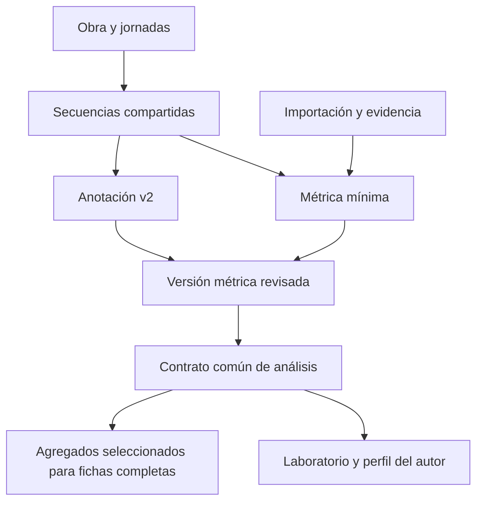

# Campos mínimos y conexión con Versología

Propuesta concreta del 22 de octubre de 2026, a partir del
[diseño de integración](./diseno-integracion.md). **No aplicada a la DB.** Los campos nuevos se
describen para revisar el contrato antes de escribir la migración. Los nombres existentes se
contrastaron con [consultas de solo lectura](../../scripts/importador-metrico/auditar-campos.sql);
la [evidencia](./piloto/auditoria-campos-2026-10-22.json) conserva columnas y referencias observadas.

## Lo que rellena o confirma la persona

El mínimo para incorporar una obra al corpus cronológico es: **título, autoría con su fuente,
edición base, intervalo de fechas con su fuente, jornadas y secuencias con rangos revisados**.
Cada secuencia conserva la denominación editorial y la forma identificada hasta donde se pueda.
La forma puede quedar sin resolver. No se requieren arquitectura, personajes, cuadros ni sinopsis.

Una entrada incompleta puede conservarse como borrador de importación, con sus incidencias.
Todavía no es una obra apta para el corpus: una cifra ilegible no se transforma en cero y no se
crea una secuencia sin rango válido en la tabla común.

| Dato de entrada | Obligatorio para el corpus mínimo | Destino |
| --- | --- | --- |
| Título | Sí | `obras.titulo`; slug y normalización se generan |
| Autoría y fundamento | Sí, aunque la atribución pueda ser discutida | Modelo común de atribuciones; no un autor escrito solo como texto |
| Edición base | Sí | `obras.edicion` y copia de procedencia en la importación |
| Fecha inicial y final | Sí; pueden coincidir | `obras.fecha_inicio_trad`, `fecha_fin_trad` para la datación recibida de la bibliografía |
| Fuente de esa datación | Sí | `obras.fuente_fecha` |
| Género | No para comparar métrica | `obras.genero_id` si se identifica; literal conservado en origen |
| Jornadas con número y límites | Sí | `jornadas` |
| Secuencias con límites | Sí | `secuencias_metricas` |
| Denominación de la edición y localizador | Sí, o incidencia explícita de ilegibilidad | Original de importación, vinculado a cada anotación mínima |
| Forma y arquitectura | Solo lo identificado y revisado | Tabla métrica mínima separada de v2 |
| Detalles adicionales y desviaciones | Opcionales | Datos mínimos tipados, con evidencia |
| Editor asignado | No para importar | Asignación editorial posterior o explícita |

No se copian automáticamente esas fechas a `fecha_inicio_metadrama` / `fecha_fin_metadrama`,
que expresan otra propuesta de datación. Una hipótesis alternativa se conserva con su fuente y
no sustituye el intervalo seleccionado sin decisión explícita. El original admite esas alternativas;
la proyección cronológica declara qué datación emplea y no inventa un año medio.

Registrar una atribución no implica incluirla sin más en el perfil de un autor. Se reutilizan
`grupos_atribucion`, `atribuciones` y `atribucion_autores`, sus vocabularios y `fuente_autoria`.
La elección `perfil_metrico` es deliberada. El criterio actual de `perfil_metrico_unidades()` exige
un grupo con una única atribución seleccionada y un único autor; los casos discutidos se conservan
y se filtran según el estudio. El importador no inventa tipos de atribución ni los decide por IA.

## Qué se añade a la obra y qué se reutiliza

| Campo o tabla | Propuesta |
| --- | --- |
| Nuevo `obras.tipo_ficha` | `minima` o `completa`, con `completa` como valor de compatibilidad para lo existente. Describe el recorrido de trabajo, no certifica que un borrador esté terminado |
| Nuevo `obras.base_metrica_analitica_id` | Referencia opcional a una versión métrica revisada de esa misma obra. Permite mantener la base mínima mientras se trabaja en v2 |
| `obras.estado` | Se conserva el circuito editorial. Una mínima no adquiere el estado publicado para entrar en el corpus |
| `obras.visible_publico` | Falso para mínimas, con guarda en la DB y comprobación en servidor |
| `jornadas` | Se reutilizan `obra_id`, `jornada_num`, `v_ini`, `v_fin`. Los rótulos originales quedan en la fuente |
| `secuencias_metricas` | Se reutilizan `obra_id`, `v_ini`, `v_fin`, `n_versos`. No se añade una segunda colección de secuencias |

Los rangos son inclusivos; el guardado calcula `n_versos = v_fin - v_ini + 1`, en vez de confiar
en otra cifra enviada por el cliente. El total impreso se conserva aparte para detectar diferencias.
`obras.total_versos` se completa solo después de conciliar jornadas, secuencias y numeración,
no sumando filas posiblemente duplicadas. Si hay lagunas, se distingue extensión numerada de
versos documentados antes de describir el denominador como versos presentes.

Las jornadas no se superponen; cada secuencia mínima queda dentro de una jornada de su obra.
Hoy la secuencia no tiene `jornada_id`: la pertenencia se valida por los rangos comunes.
La primera versión del guardado pide una partición continua del ámbito numerado acordado,
sin reinicios de numeración sin resolver. Un hueco de extracción se conserva en borrador hasta
representarlo correctamente; una laguna declarada por la edición no se oculta para lograr continuidad.

Se dejan a `null` las caracterizaciones no estudiadas y `estrofa_tipo_id`, que es legado.
Los flags de obra `sin_figuras_donaire`, `sin_personajes_sobrenaturales` y
`sin_eventos_sobrenaturales` se mantienen falsos: no se ha declarado ausencia global.
No se introducen cuadros ficticios para satisfacer el checklist completo.

## Tabla principal: `secuencias_metrica_minima`

Contiene la **interpretación mínima vigente**, no la respuesta sin revisar de una IA.
Una fila por secuencia; la historia aceptada se conserva en las versiones de obra descritas abajo.

| Campo nuevo | Tipo propuesto | Obligación y significado |
| --- | --- | --- |
| `metrica_minima_id` | UUID, PK | Generado en servidor |
| `secuencia_id` | UUID, FK y único | Referencia a `secuencias_metricas`; determina obra y rango, sin duplicarlos aquí |
| `forma_id` | UUID, FK, nullable | Forma confirmada en `formas_metricas`. `null` significa que no se ha identificado |
| `arquitectura_id` | UUID, FK, nullable | Arquitectura confirmada en `arquitecturas_forma`; requiere forma y pertenencia a ella |
| `segmentacion` | `confirmada` / `provisional` | Distingue secuencias establecidas según el criterio interno de bloques cuya partición aún no puede decidirse |
| `alcance_candidatas` | `orientativas` / `exhaustivas`, nullable | Solo si hay candidatas; exhaustivas exige justificación que descarte otras alternativas |
| `fundamento` | Texto no vacío | Razón de la interpretación, incluida la decisión de mantenerla abierta |
| `revision` | Entero positivo | Control de concurrencia y versión de esta interpretación; lo incrementa el servidor |
| `revisado_por` | UUID, FK a `editores.user_id` | Persona autenticada que acepta esta interpretación; no lo proporciona el modelo |
| `revisado_en` | Fecha/hora | Momento de aceptación, generado en servidor |
| `created_at`, `updated_at` | Fechas/horas | Auditoría técnica |

No se almacena otra columna redundante de «estado de identificación»: se deriva de forma y
candidatas. Tampoco se guarda un porcentaje de confianza. Los resultados posibles son:

| Forma | Candidatas | Lectura |
| --- | --- | --- |
| Identificada | Ninguna | Forma revisada; arquitectura puede seguir desconocida |
| Identificada | Solo de arquitectura, dentro de esa forma | Forma revisada; arquitectura sigue abierta |
| Desconocida | Una o varias | Identificación abierta con alternativas; una candidata única orientativa sigue sin ser un hecho |
| Desconocida | Ninguna | Sin resolver tras revisar lo disponible |

Una interpretación revisada puede estar sin resolver: la revisión confirma la fidelidad y los
límites de lo afirmado. Las propuestas sin aceptación quedan en el borrador de importación,
no en `forma_id`. No se asigna `irregular` ni `verso_aislado` como sustituto de desconocido.

`segmentacion` es independiente: conocer el rango de una fila editorial no demuestra que sea
una secuencia de nuestro sistema. Las formas conocidas pueden aportar versos al perfil aunque
subsista una duda de partición; el número de secuencias y las transiciones requieren comprobarla.
No se fracciona un bloque sin límites documentados.

## Candidatas, fuentes y detalles: datos dependientes

Son tablas auxiliares de la métrica mínima, no un corpus paralelo ni una copia de las preguntas v2.
La ausencia de filas de detalle significa **sin información registrada**, nunca «no ocurre».

### `metrica_minima_candidatas`

Campos: `candidata_id` UUID PK, `metrica_minima_id` FK, `forma_id` FK obligatorio,
`arquitectura_id` FK opcional y `fundamento` obligatorio. No se repite el mismo destino.
Una arquitectura candidata debe pertenecer a su forma. No hay pesos ni orden de probabilidad.

Se permiten candidatas de arquitectura manteniendo una forma ya identificada, siempre que todas
pertenezcan a esa forma. En ese caso la incertidumbre es de arquitectura, no de forma: no reduce
la cobertura del perfil de formas. Si se conoce también la arquitectura, no hay candidatas vigentes.
El conjunto `alcance_candidatas` se interpreta en el nivel que sigue abierto.

### `metrica_minima_fuentes`

Campos: `referencia_id` UUID PK, `metrica_minima_id` FK, `importacion_id` FK,
`tramo_ref` texto obligatorio, `notas_ref` lista de referencias y `regla_ref` opcional.
El guardado comprueba que fila, notas y regla existen en el paquete versionado de importación.
No se admite enlazar evidencia de otra obra.

La denominación literal, página, foto, nota y rango de origen se leen de ese paquete. No se
mantiene otra copia editable del literal en la anotación. Una fila puede originar tres secuencias
y una secuencia puede enlazar varias filas. Las notas no son secuencias nuevas por defecto.

### `metrica_minima_detalles`

Esta tabla permite conservar más información sin exigir arquitectura o unidades completas.
Las filas se revisan junto con su anotación y comparten su número de revisión.

| Grupo de campos | Campos propuestos y regla |
| --- | --- |
| Identidad | `detalle_id` UUID PK, `metrica_minima_id` FK y `referencia_id` FK a evidencia de esa misma anotación |
| Tipo | `tipo`: `metro`, `tipo_rima`, `esquema_rima`, `rasgo`, `seccion` o `desviacion` |
| Alcance | `alcance`: `secuencia`, `rango` u `ocurrencia`; `v_ini`, `v_fin` opcionales como pareja. Rango exige coordenadas; ocurrencia puede no tenerlas. Los rangos conocidos deben quedar dentro de la secuencia |
| Entidades del catálogo | `metro_id`, `tipo_rima_id`, `esquema_rima_id`, `valor_rasgo_id`, todos opcionales con FK y combinaciones restringidas por tipo |
| Sección declarada | `tipo_seccion`, `seccion_id` opcional, `forma_componente_id` opcional, `n_versos_declarados` opcional y `posicion` opcional: inicio/interior/final |
| Desviación declarada | `dimension`, `relacion_norma`, `norma_referencia`; reutiliza los identificadores observados pertinentes y la extensión/localización disponible |
| Numeración de una falta | `posiciones_falta`: `incluidas`, `no_incluidas` o `sin_determinar`, solo para desviación estructural `falta` |
| Justificación | `fundamento` obligatorio y `literal_ref` opcional como localizador dentro de la evidencia, sin convertir prosa libre en un valor métrico |

Se aplican combinaciones cerradas, no un registro con todas las columnas libremente rellenables:

- `metro`, `tipo_rima`, `esquema_rima` y `rasgo` exigen su correspondiente referencia y excluyen
  las otras entidades, los campos de sección y los de desviación.
- `tipo_rima_id` referencia `vocabularios.termino_id`, con validación de su categoría. Esa es la
  referencia real del catálogo actual; no se propone una tabla ficticia de tipos de rima.
- Un `esquema_rima_id` pertenece a una arquitectura existente: solo se usa cuando esa arquitectura
  y el ámbito del esquema estén identificados. Saber simplemente «asonante» no selecciona un esquema.
- Una sección puede identificarse solo por su función, como `remate`, sin `seccion_id`. El tipo se
  contrasta con las secciones de la forma conocida y la interpretación se revisa; no es un término
  libre que cree conceptos nuevos. Si se informa `seccion_id`, debe pertenecer a la arquitectura
  identificada. `forma_componente_id` describe la sección, no la forma de toda la secuencia.
- En `desviacion`, `dimension` y `relacion_norma` usan las distinciones ya empleadas en el dominio
  para el caso admitido. La primera versión cubre metro (`menor_que_norma`, `mayor_que_norma`,
  `otra`) y estructura (`sobra`, `falta`, `otra`). Otros tipos requieren ampliar el contrato,
  no colar claves o relaciones libres. Una desviación de metro exige el metro observado si está
  identificado; una de estructura no exige inventar un metro.
- `norma_referencia` explica con qué se compara la desviación cuando no hay arquitectura:
  por ejemplo, el endecasílabo declarado por la edición. No certifica el resto de la norma.
- Dos detalles contradictorios para el mismo ámbito deben revisarse. Una declaración general
  y su desviación localizada se conservan como tales; no se cuentan como dos metros que cubren
  simultáneamente todo el pasaje. La regla para calcular el metro efectivo debe declararse.

No se deduce distribución interna, rima de cada verso ni número de unidades por división de la
longitud. Un detalle que todavía no encaje en un tipo se conserva como evidencia, fuera del cálculo,
hasta ampliar el contrato. El comentario «probable descuido» continúa siendo opinión de la edición.

Para `sobra` con rango conocido, la comprobación de extensión normativa resta la unión de sus
posiciones, sin descontar dos veces solapamientos. Los versos permanecen en la extensión del pasaje.
Para `falta`, no se añaden de nuevo posiciones ya incluidas en la numeración. Si no se sabe cómo
cuenta la fuente, se conserva la falta y queda pendiente el ajuste normativo; no se inventa un rango
ni se resuelve con una suma automática. Estas distinciones no cambian el registrador v2 existente.

## Procedencia: `importaciones_metricas`

Un paquete corresponde a una obra y una versión del procedimiento. Agrupa fuente e interpretación
para que las referencias internas sigan siendo recuperables. Una transcripción aceptada se conserva
íntegra aunque luego se vuelva a normalizar.

| Campo propuesto | Función |
| --- | --- |
| `importacion_id`, `obra_id` | Identidad y FK de la obra de destino |
| `extraccion_original`, `sha256_original`, `formato_version` | Texto recibido, hash de sus bytes UTF-8 calculado por el servidor y contrato de parseo. No calcular ese hash sobre un JSONB reordenado |
| `fuentes` | Manifiesto versionado: identificador, localizador/nombre de archivo y hash cuando se disponga; edición y metadatos declarados. No exige subir fotografías a Git |
| `normalizacion` | Paquete versionado de propuestas, decisiones aceptadas, incidencias y transformaciones fila→secuencia, con las reglas utilizadas y sus fundamentos |
| `prompt_version`, `reglas_version`, `catalogo_referencia` | Versiones y hashes; referencia recuperable a reglas y catálogo usados. No basta con guardar una fecha si los contenidos pueden cambiar |
| `estado_transcripcion` | Pendiente / aceptada; aceptación con `transcripcion_revisada_por` y `transcripcion_revisada_en` |
| `creado_por`, `created_at` | Quién registra y cuándo |

Los bloques estructurados tienen contrato cerrado y versionado: no sustituyen las FK de las
formas, candidatas y detalles. Los originales aceptados no se editan; una corrección o una nueva
normalización se registra como otro paquete que referencia al anterior mediante `sustituye_a`.
Eso no duplica la obra ni cambia automáticamente su base analítica.

La confirmación se ejecutará en una transacción: validar paquete, metadatos y referencias;
resolver la identidad de obra; crear o actualizar únicamente el ámbito autorizado; guardar
estructura, anotación y vínculos; registrar la versión revisada y su selección. Repetir la misma
confirmación no crea otra obra ni otro juego de secuencias: una clave de idempotencia identifica
la operación. Un título parecido solo propone una coincidencia; no autoriza fusionar obras.
Una reimportación sobre trabajo existente muestra el conflicto y no lo sobrescribe. La revisión
esperada y los hashes de entrada detectan cambios concurrentes antes de confirmar.

La aprobación de la transcripción y la de su interpretación son independientes. Si alguien revisó
la foto fuera de la plataforma, se conserva su declaración y el usuario autenticado registra la
aceptación, sin inventar una cuenta o UUID para el revisor externo. La primera versión puede
conservar los borradores sin crear estructura canónica hasta confirmar la importación.

## Base analítica: `versiones_metricas_obra`

Hace falta identificar una base revisada, no solo marcar la obra como «importada».

| Campo propuesto | Función |
| --- | --- |
| `version_metrica_id`, `obra_id` | UUID y FK; la selección de `obras.base_metrica_analitica_id` debe pertenecer a esa misma obra |
| `origen` | `minima` / `v2`. Una versión usa una base explícita; no mezcla fragmentos de distinta revisión por prioridad automática |
| `contrato_version`, `entrada`, `sha256_entrada` | Instantánea inmutable de los datos revisados: identidad, edición, fechas, autoría seleccionada, estructura, anotación, detalles, evidencias y versiones de catálogo/reglas necesarias para reproducirla |
| `revisado_por`, `revisado_en` | Aceptación de esa base, aunque parte de sus identificaciones continúe pendiente |
| `created_at` | Registro de la versión |

`entrada` es evidencia versionada de lo que se aprobó, no otra tabla de obras o secuencias editable.
Los cálculos y artefactos siguen siendo proyecciones regenerables. Sus claves deben incluir versión
de entrada y versión del algoritmo. La instantánea no contiene solo los resultados calculados.

El hash se calcula sobre una serialización canónica definida por el contrato; incluye contenido
relevante y referencias recuperables, no depende de marcas de tiempo ajenas al análisis.
Un cambio de forma, rango, fecha, autoría o detalle no reescribe una versión aceptada.

La asignación a un editor y el paso al recorrido completo no sustituyen esa base. Mientras v2 está
en trabajo se puede seguir usando la versión mínima seleccionada, identificada como tal. Al adoptar
la versión detallada revisada se cambia una sola referencia y se recalculan sus dependencias.
Cada estudio cuenta como máximo una versión de cada obra. No basta con encontrar una fila v2 para
darle prioridad ni se suman ambas representaciones.

## Contrato común de lectura y conexión con los consumidores

El adaptador mínimo y el de v2 producen un mismo contrato analítico versionado. No se insertan
anotaciones v2 incompletas para conseguirlo. Su salida necesita:

Se selecciona una base revisada de cada obra; las dos flechas a la versión no representan una suma
de ambas anotaciones. La ampliación a v2 conserva la identidad de las secuencias que no cambien.

| Bloque | Contenido necesario |
| --- | --- |
| Identidad de entrada | `obra_id`, `version_metrica_id`, `origen`, edición y versiones de contrato/algoritmo |
| Contexto | Fechas seleccionadas con fuente y alternativas; atribuciones seleccionadas con ámbito |
| Estructura | Jornadas y segmentos con rangos; grado de resolución de la partición |
| Métrica | Forma confirmada nullable, arquitectura confirmada nullable, candidatas con su alcance y detalles admitidos |
| Cobertura | Ámbito numerado esperado, rangos documentados, rangos con forma y arquitectura identificadas, ámbitos de detalles y límites/transiciones interpretables |
| Disponibilidad por medida | Valor o resultado parcial, unidad, denominador, cobertura y motivo de indisponibilidad o límites. No un único booleano `apta` para todas las preguntas |

Se calculan las coberturas desde rangos y hechos de la versión aceptada, no desde porcentajes
introducidos por la persona o por la IA. Si falta parte del ámbito, no se presenta la unión de
rangos conocidos como si fuera toda la obra. Las candidatas orientativas no estrechan los límites
como si fueran exhaustivas. Una secuencia desconocida no desaparece de los denominadores.

| Consumidor actual | Conexión propuesta |
| --- | --- |
| Dashboard y creación de obra | Recorrido mínimo propio: metadatos, vista previa de secuencias, incidencias y revisión. No exigir editor, cuadros ni checklist completo |
| Registrador y guardado v2 | Mantener sus tablas y exigencias; mostrar la base mínima como evidencia y punto de partida opcional |
| Checklist y publicación | Mínima nunca satisface revisión completa. Cambiar `tipo_ficha` no publica ni completa automáticamente nada |
| `formas_de_la_obra` y cálculo del perfil | Incorporar un adaptador explícito a la nueva lectura analítica, conservando las restricciones de los lectores públicos. No hacer una unión indiscriminada de ambas anotaciones |
| Perfil de autor y cronologías | Usar bases seleccionadas y atribuciones pertinentes, con fechas y cobertura; contar una vez cada obra |
| Laboratorio y distancias | Universo ampliado explícito. Adaptar denominadores y medidas antes de incluir datos mínimos; no renormalizar lo conocido al 100 % sin declararlo |
| Artefactos e índices públicos | Las mínimas no aparecen como fichas ni análisis individuales descargables. La matriz ampliada permanece bajo sus permisos internos |
| Comparativas de una ficha completa | Proyección agregada seleccionada que puede usar el corpus mínimo; declara composición, `n`, cobertura, datación y versión. No entrega las filas privadas |

Al publicar una ficha completa, su análisis individual debe corresponder a la versión v2 revisada
de esa ficha; no se presenta una antigua base mínima como si describiera la anotación detallada.
La selección de versión y la generación de sus artefactos se coordinan con la revisión/publicación.
El despliegue conservará los lectores completos actuales hasta adaptar y verificar su reemplazo;
añadir un selector inicialmente vacío no debe borrar sus perfiles ni aprobar borradores existentes.

La publicación individual y el universo estadístico son decisiones diferentes. El agregado difundible
puede usar mínimas validadas, sin requerir que sus fichas estén publicadas. Las reglas para excluir
la propia obra, ponderar y decidir estabilidad se definirán por medida, como recoge la metodología.

## Casos de aceptación del contrato

| Caso | Representación esperada y límite |
| --- | --- |
| Canción, 221–287 de El verdadero amante | Forma Canción, arquitectura `null`. Detalle `seccion`, tipo `remate`, componente Pareado, 2 versos declarados y posición final. No se inventan coordenadas absolutas ni patrón de las estancias |
| Tercetos sin precisión | Forma `null`, candidatas Terceto y Terceto encadenado, alcance orientativo mientras no se justifique exhaustividad. Revisión posible sin resolver la forma |
| Forma conocida, arquitectura ambigua | Forma confirmada y candidatas de arquitectura dentro de ella. Cobertura de forma completa para ese rango; de arquitectura aún desconocida |
| Letrilla | Forma `null`, posibilidades orientativas conservadas; ninguna caracterización de canto ni elección forzada |
| Los locos, 2622–2754 | Se mantiene la secuencia de 133 posiciones, con desviación `estructura/sobra` en 2666. Extensión normativa 132 al comprobar esa declaración; no se resta de la obra ni se parte el tramo |
| Los locos, v. 2172 | Detalle de desviación de metro, observado Heptasílabo, respecto al endecasílabo declarado. No necesita inventar una arquitectura ni otra secuencia |
| Inserción B identificada en A | Tres secuencias y sus anotaciones mínimas, vinculadas a la misma fila/nota original si procede |
| Nota de inserción sin coordenadas | Evidencia conservada y partición provisional. No se fabrican tres rangos ni un número exacto de transiciones |
| Editor cambia límites o comienza v2 | Nueva interpretación en trabajo; la versión aceptada sigue identificada por su entrada inmutable. El cambio de referente se revisa expresamente |

Estos son criterios para las futuras pruebas de guardado y cálculo, no resultados de pruebas SQL
ya ejecutadas. En este paso se ha consultado el esquema y concretado el contrato; no se han creado
tablas, migraciones, endpoints ni obras en la base compartida.
